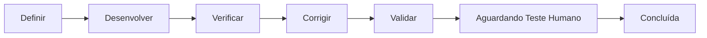

# Ferramenta de Gestão Local do Desenvolvimento com IA (Esteira IA)

**Versão:** 1.0 — 24/09/2026  
**Documento de Origem:** `Projeto_Gestao_Desenvolvimento_IA.docx`  
**Perfil:** Arquiteto de Software Sênior & Engenharia de Sistemas  

---

## 1. Visão Geral e Filosofia de Operação

A **Esteira IA** é uma aplicação local projetada para organizar e orquestrar o desenvolvimento de software conduzido por um programador humano acompanhado de **1 a 5 IAs** com nomes livres e papéis configuráveis (ChatGPT, Claude, Gemini, etc.).

### Princípios Fundamentais:
1. **Controle Humano Absoluto:** O organizador **não** chama APIs de modelos, **não** automatiza interfaces externas e **não** inicia novas etapas de forma autônoma. O usuário autoriza e aciona cada IA manualmente.
2. **Separação de Contextos:** O código do organizador é 100% isolado do código do projeto em desenvolvimento.
3. **Persistência Transacional:** O banco SQLite local (`esteira.db`) é a fonte oficial da verdade dos estados, transições e regras de negócio.
4. **Espelhamento em 4 Markdowns:** Cada projeto acompanhado mantém na raiz a pasta `/gestao-ia/` com os arquivos `Projeto.md`, `Tarefas.md`, `Decisões.md` e `Validação.md`.
5. **Garantia de Integridade e Conciliação:** Hashes SHA-256 rastreiam edições externas nos documentos. Alterações manuais feitas no disco são detectadas e exigem conciliação formal antes de qualquer avanço silencioso.
6. **Segurança Local Rigorosa:** Escuta estritamente em `127.0.0.1` (localhost), protege contra CSRF, bloqueia path traversal em caminhos de arquivos e não executa comandos arbitrários vindos de payloads.

---

## 2. Stack Tecnológica

- **Backend:** Node.js v24.15.0 nativo.
- **Banco de Dados:** SQLite nativo via módulo padrão `node:sqlite` (`DatabaseSync`), sem necessidade de compilações C++ nativas no Windows.
- **Servidor HTTP:** Módulo `node:http` nativo estruturado com API REST e roteamento estático seguro.
- **Frontend:** Single Page Application construída com HTML5 semântico, Vanilla CSS moderno (Dark Mode refinado, conformidade com acessibilidade WCAG, ícones e textos semânticos) e Vanilla JavaScript (ESM).
- **Testes:** Suíte automatizada com `node:test` e `node:assert`.

---

## 3. Estrutura do Repositório

```text
EsteiraDeDesenvolvimentoComIA/
├── Decisões.md                     # Registro de escolhas técnicas e deliberações pendentes
├── README.md                       # Documentação técnica e guia de operação
├── package.json                    # Configurações do projeto Node.js (ESM)
├── seed.js                         # Carga opcional de dados de demonstração
├── src/
│   ├── server.js                   # Servidor HTTP, middleware de segurança e rotas REST
│   ├── contracts/
│   │   └── deliverySchema.js       # Validador do JSON Schema v1.0 e anti-path-traversal
│   ├── db/
│   │   ├── schema.sql              # Estrutura transacional das tabelas SQLite
│   │   └── database.js             # Módulo de banco com gerador de IDs imutáveis (PRJ, TSK, etc.)
│   └── services/
│       ├── projectService.js       # Gestão de projetos, funcionalidades, IAs e tarefas
│       ├── documentSyncService.js  # Escrita atômica e verificação de hashes SHA-256
│       ├── stateMachineService.js  # Rito das 5 etapas, concorrência e regras de bloqueio
│       ├── ingestionService.js     # Ingestão de entregas, idempotência e aceite humano
│       ├── promptGeneratorService.js# Geração do prompt oficial de retomada (Seção 10)
│       ├── watcherService.js       # Observador de arquivos da pasta /gestao-ia/entrada
│       └── backupService.js        # Exportação e restauração transacional
├── public/
│   ├── index.html                  # Interface do Dashboard Kanban e modais
│   ├── css/style.css               # Design System dark mode com Vanilla CSS
│   └── js/app.js                   # Lógica reativa da interface e drag-and-drop
└── tests/
    └── esteira.test.js             # Suíte de testes automatizados completa
```

---

## 4. O Rito Obrigatório de 5 Etapas

Cada funcionalidade percorre sua própria esteira pelas etapas sequenciais:



1. **Definir:** Consolidação do escopo, requisitos e critérios de aceite. Exige **aprovação humana** dos requisitos antes de liberar o desenvolvimento.
2. **Desenvolver:** Implementação exclusiva do escopo autorizado. Gera entrega com lista de arquivos e alterações.
3. **Verificar:** Confronto entre implementação e requisitos. Execução de testes automatizados e análise de segurança. Se não houver inconformidades, permite registrar formalmente **Correção Dispensada** com justificativa para seguir direto à validação.
4. **Corrigir:** Resolução de erros e defeitos. Cada reprovação de uma entrega de correção incrementa o contador da funcionalidade. Ao atingir **3 rodadas reprovadas**, a funcionalidade é automaticamente **suspensa** para deliberação humana.
5. **Validar:** Reexecução de testes de regressão e conferência de critérios de aceite na versão entregue.
6. **Teste Humano:** Obrigatório antes da conclusão. Apenas a aprovação explícita do usuário transita a tarefa para `concluida`. Reprovação retorna a `Corrigir` (se defeito) ou a `Definir` (se mudança de requisito).

---

## 5. Instruções de Instalação e Execução

### Pré-requisitos
- Node.js >= 22.0.0 (recomendado Node.js 24).
- Não requer nenhuma instalação de banco de dados externo ou compilação C++.

### 1. Executar os Testes Automatizados
```bash
npm test
```
*Executa a suíte de 12 testes automatizados validando concorrência, idempotência, segurança e regras de transição.*

### 2. (Opcional) Carregar Dados de Demonstração
```bash
node seed.js
```
*Inicializa um projeto de exemplo com tarefas, funcionalidades e uma decisão pendente.*

### 3. Iniciar o Servidor Local
```bash
npm start
```
*Acesse a interface no navegador em:* **`http://127.0.0.1:3000`**

---

## 6. Contrato da Entrega (JSON Schema v1.0)

As IAs entregam seus trabalhos depositando um arquivo `.json` (escrevendo como `.tmp` e renomeando ao concluir) em `<raiz-do-projeto>/gestao-ia/entrada/` ou através do botão **"Importar Entrega"** no dashboard:

```json
{
  "schema_version": "1.0",
  "submission_id": "sub-exemplo-001",
  "project_id": "PRJ-001",
  "feature_id": "FUN-001",
  "task_id": "TSK-001",
  "execution_id": "EXE-001",
  "stage": "Desenvolver",
  "actor_id": "IA-002",
  "previous_delivery_ref": null,
  "base_revision": 1,
  "title": "Implementação do módulo de autenticação",
  "description": "Desenvolvimento do fluxo de geração de tokens JWT",
  "context_read": ["gestao-ia/Projeto.md", "gestao-ia/Tarefas.md"],
  "code_version": { "commit": null, "manifest_ref": "evidencias/manifesto.json", "dirty": true },
  "files": [
    { "path": "src/auth/jwt.js", "operation": "created", "description": "Lógica de assinatura de tokens" }
  ],
  "logic_changes": ["Adicionado suporte a HMAC SHA-256"],
  "documentation_updates": [],
  "tests": [
    { "test_id": "TST-001", "status": "passed", "command": "npm test auth", "environment": "node24" }
  ],
  "errors": [],
  "decision_requests": [],
  "blockers": [],
  "recommended_next_stage": "Verificar",
  "handoff_notes": "Pronto para auditoria de segurança."
}
```

---

## 7. Limitações Reais e Considerações de Segurança

1. **Isolamento de Arquivos:** As reservas de recursos (`reserved_resources`) coordenam o trabalho das IAs cadastradas no sistema para evitar concorrência interna, mas **não** impedem fisicamente edições manuais feitas no sistema operacional fora da aplicação.
2. **Detecção de Divergências:** Se arquivos Markdown forem editados externamente, a ferramenta acusa divergência por hash SHA-256 e exige conciliação explícita pelo botão `Sincronizar Docs`.
3. **Execução de Comandos:** A aplicação não executa comandos arbitrários recebidos nos payloads de entrega.
4. **Área de Agentes Visuais:** O espaço inferior é recolhível e reservado para a visualização de agentes com a identificação *"Visualização dos agentes — em breve"*, sem animações falsas ou motores de jogo artificiais no MVP.

---

## 8. Tutorial Interativo de Primeira Utilização ("Missões de Jogo")

A aplicação inclui um onboarding interativo orientado a missões práticas com 9 etapas progressivas:

1. **Escolher a pasta do projeto:** Validação de permissões, existência e detecção de `/gestao-ia` anterior para reaproveitamento seguro.
2. **Conectar a ferramenta de IA ao projeto:** Suporte a acesso local (com token temporário `CONFIRM-IA-...` validado e descartado automaticamente) ou modo de importação manual pelo navegador.
3. **Preparar a arquitetura de documentação:** Apresentação da árvore documental `/gestao-ia/` com prompt de inspeção oficial.
4. **Cadastrar as IAs participantes:** Atribuição de 1 a 5 IAs cobrindo o rito completo.
5. **Descrever a primeira funcionalidade:** Cadastro da funcionalidade inicial e geração da tarefa de Definir.
6. **Iniciar a tarefa e copiar o prompt:** Autorização da execução (`EXE-xxx`) e disponibilização do prompt formatado (Seção 10).
7. **Receber a primeira entrega:** Ingestão monitorada ou importação manual com validação de conformidade.
8. **Conferir e aceitar:** Aprovação dos requisitos, conferência de arquivos/testes e aceite com incremento de revisão.
9. **Entender o próximo passo:** Passagem para a etapa Desenvolver e ativação opcional de dicas contextuais.

